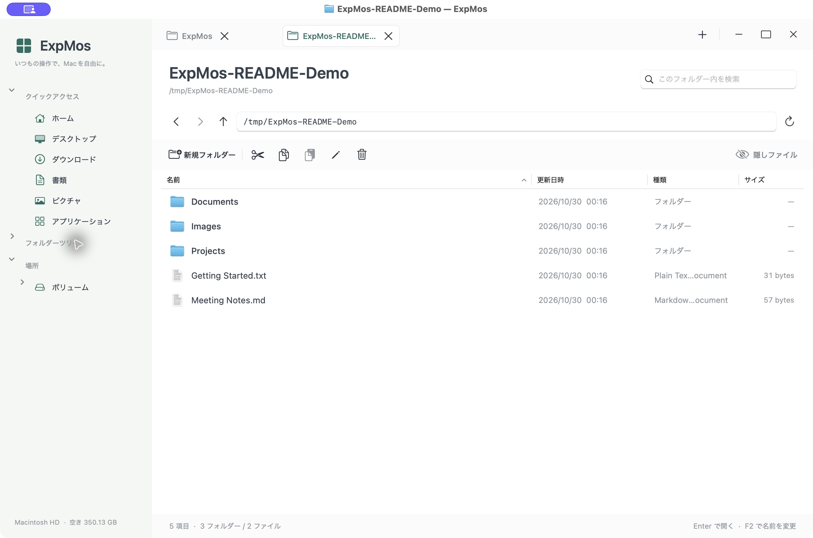
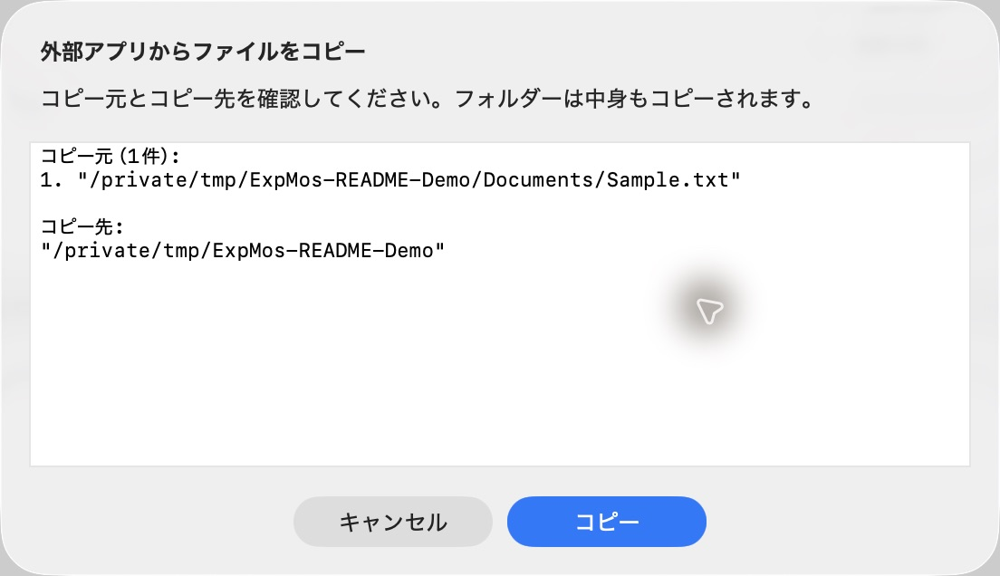

# ExpMos

Windowsのエクスプローラーに近い操作感を目指した、macOS用のファイル管理アプリです。フォルダーツリー、タブ、パスの直接入力、コピー・切り取り・貼り付けを、Swift / AppKit製のネイティブアプリで使えます。



*サンプル用フォルダーを表示した実際のアプリ画面です。*

## 起動

[GitHub Releases](https://github.com/J0hnSm1thyk/ExpMos/releases/latest) から `ExpMos-0.1.0-macOS-universal.zip` をダウンロードして展開し、`ExpMos.app` をアプリケーションフォルダーへコピーして起動してください。macOS 13以降のApple Silicon / Intel Macに対応しています。`SHA256SUMS.txt` も同じリリースで配布します。

ソースから作成する場合（macOS 13以降、Swift 6 / Command Line Toolsが必要）:

```sh
./scripts/build-app.sh
open dist/ExpMos.app
```

配布用のUniversalバイナリを作成する場合は `./scripts/build-app.sh --universal` を使います。アプリ本体とビルドキャッシュはGitに含めず、バイナリはReleasesで配布します。

## 画面の見方

| 場所 | できること |
| --- | --- |
| 左のサイドバー | ホーム、ダウンロード、書類などへ移動。フォルダーツリーを展開してフォルダーをたどる |
| 上部のタブ | 複数のフォルダーを開いて切り替え。`＋` で追加、タブの `×` で閉じる |
| 右上の `−` / `□` / `×` | ウィンドウを最小化・最大化／元に戻す・閉じる |
| パス欄と矢印 | パスを直接入力。戻る・進む・親フォルダーへの移動 |
| ツールバー | 新規フォルダー、切り取り、コピー、貼り付け、名前変更、ごみ箱、隠しファイルの切り替え |
| ファイル一覧 | 複数選択、ダブルクリックで開く、列ヘッダーで並べ替え、右クリックで追加操作 |
| 右上の検索欄 | 表示中フォルダーの直下にある項目を、名前で絞り込み |

最大化はメニューバーとDockを除いたデスクトップ領域に広げます。右上の操作ボタンは、左上に出るmacOSの共有表示と重ならない位置に配置しています。共有表示自体はmacOS側の表示です。

## 基本操作

### フォルダーを開く

サイドバーでフォルダーを選ぶか、一覧のフォルダーをダブルクリックします。`⌘L` でパス欄を選び、絶対パス、相対パス、`~/Downloads`、`file://` URLを入力してEnterでも移動できます。ファイルを開く場合は、既定のアプリで開きます。

タブごとに戻る・進むの履歴を保持し、次の起動時には開いていたフォルダーを復元します。

### コピー・移動する

1. 一覧でファイルやフォルダーを選択します。複数選択にも対応しています。
2. コピーは `⌘C`、移動は `⌘X` で切り取ります。
3. 移動先のフォルダーを開き、`⌘V` で貼り付けます。

同名の項目がある場合は `report (2).txt` のように番号を付け、既存のファイルを保持します。切り取り状態はExpMos内で管理するため、移動はExpMosへの貼り付けで行ってください。一覧でEscを押すと切り取りを解除できます。

### Finderなどから貼り付ける

他のアプリでコピーしたファイルを貼り付けると、実際のコピー元とコピー先を表示します。内容を確認し、「コピー」を押すと転送します。「キャンセル」では転送しません。



ExpMos内でコピー・切り取りした項目は、確認画面を挟まずに貼り付けられます。外部からの貼り付けでは、確認中にパスが差し替えられても、保持したコピー元とコピー先を使って処理します。シンボリックリンクはリンクとしてコピーします。

### その他の操作

- 新規フォルダーの作成、名前変更、ごみ箱への移動。
- 隠しファイルの表示切り替え、名前・更新日時・種類・サイズでの並べ替え。
- 右クリックメニューから「Finderで表示」「情報を見る」。
- 表示中のフォルダーの変更を検知して一覧を更新。

## ショートカット

| 操作 | キー |
| --- | --- |
| ウィンドウを最小化 / 閉じる | ⌘M / ⌘⇧W |
| 新しいタブ / タブを閉じる | ⌘T / ⌘W |
| 次 / 前のタブ | Control+Tab / Control+Shift+Tab |
| パスの入力 / 名前検索 | ⌘L / ⌘F |
| 戻る / 進む | ⌘[ / ⌘] または Option+← / → |
| 親フォルダー | ⌘↑ または Option+↑ |
| ホームへ移動 | ⌘⇧H |
| 開く | Enter または ⌘O |
| フォルダーを新しいタブで開く | ⌘Option+O |
| コピー / 切り取り / 貼り付け | ⌘C / ⌘X / ⌘V |
| 新規フォルダー | ⌘⇧N |
| 名前を変更 | F2（Macの設定によりFn+F2） |
| ごみ箱に移動 | ⌘Delete |
| 情報を見る / Finderで表示 | ⌘I / ⌘⇧R |
| 更新 | ⌘R または F5 |
| 隠しファイルの表示 | ⌘⇧. |
| 切り取りの解除 | 一覧でEsc |

`⌘` はCommand、`⇧` はShiftです。

## 現時点の範囲

検索は表示中フォルダーの直下の名前検索です。ドラッグ＆ドロップ、再帰検索、Quick Look、ファイル操作のUndo、コピーの中断、ネットワーク共有への接続UIは未実装です。ごみ箱から戻す操作はFinderで行えます。

コピー・移動はバックグラウンド処理で、処理中は追加のファイル操作を停止します。処理できない項目がある場合はエラーを表示します。アプリによるデータ通信やアクセス解析はありません。

macOSの保護されたフォルダーは、初回のアクセス許可が必要になる場合があります。アクセスできないフォルダーはエラーを表示します。このローカルビルドは開発用のアドホック署名で、配布用の公証は行っていません。

## 検証

```sh
swift run ExplorerCoreChecks
```

一時フォルダーを使う17件のチェックで、次の動作を検証します。

- コピー・移動時の同名衝突と既存データの保持、部分失敗、選択した子項目の重複転送防止。
- 自分自身や配下への転送拒否、シンボリックリンク経由の循環防止、名前の検証。
- 隠しファイルの表示切り替え、ナビゲーション履歴。
- クリップボードの変更検出、外部貼り付けのコピー元・コピー先の差し替え対策。
- 外部貼り付けでのフォルダー・リンクのコピー、確認後に発生する再帰の検出、特殊ファイルの拒否。

リリース構成で実行する場合は `swift run -c release ExplorerCoreChecks` を使います。
